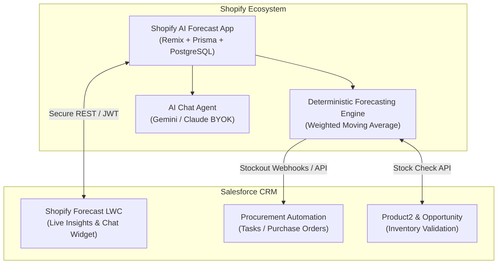

# Shopify AI Forecast & Inventory Intelligence Bridge

> **Open-Source (MIT)** | Companion to `shopify-ai-forecast-app` | Open for PRs & Discussions

## 1. Overview & Vision
A vertical open-source companion app connecting your **Shopify AI Forecast Agent** (`shopify-ai-forecast-app`) directly into Salesforce CRM.

While generic connectors only move raw orders and customer records, this specialized bridge brings **deterministic inventory forecasting, stockout warnings, and conversational AI insights** straight into Salesforce for procurement managers, operations teams, and B2B sales reps.

---

## 2. Core Features (Deep Synergy with `shopify-ai-forecast-app`)

### A. Proactive Stockout & Reorder Automation
- Whenever the deterministic forecast engine in your Shopify app calculates that a SKU is hitting its reorder point (`days_of_cover <= lead_time`):
  - A webhook is dispatched to Salesforce.
  - Automatically generates an urgent **Procurement Task** or **Case** for the purchasing manager.
  - Can automatically draft a **Purchase Order / Vendor Order record** with recommended order quantities.

### B. "Shopify Forecast Intelligence" LWC Component
- An embedded Lightning Web Component on the Salesforce `Product2`, `Opportunity`, or Home page.
- Displays live inventory health directly from the Shopify app:
  - Multi-location stock count.
  - Weighted Moving Average (WMA) daily usage.
  - Calculated Days-of-Cover and Reorder Point.
  - Status badges: `Critical Stockout Risk`, `Reorder Soon`, `Healthy`.

### C. In-Salesforce Conversational AI Agent
- Salesforce users can open the LWC card and ask conversational inventory questions:
  - *"Which products will run out before Black Friday?"*
  - *"How many units of SKU-104 should we order from supplier X?"*
- Powered by the same BYOK (Bring Your Own Key) Gemini / Claude architecture implemented in your Shopify app, ensuring zero hallucination over the deterministic numbers.

### D. B2B Deal Protection (Opportunity Stock Check)
- When a sales rep adds a product to an Opportunity or Quote in Salesforce, the component verifies current Shopify stock and forecasted restock dates in real time.
- Prevents sales reps from committing large wholesale orders to inventory that is already depleted on the storefront.

---

## 3. Architecture & Tech Stack

---

## 4. Market Position & AppExchange Moat
- **Unique Selling Proposition (USP):** No other connector on AppExchange or the Shopify App Store links AI demand forecasting with Salesforce CRM operations.
- **Cross-Promotion:** Merchants installing your Shopify app are prompted: *"Also using Salesforce? Install our free Salesforce Forecast Bridge on AppExchange to keep your sales and ops teams in sync."*

---

## 5. Open-Source Roadmap & Good First Issues for PRs
- [ ] Automated Slack / Microsoft Teams notification bridge when stockout tasks trigger.
- [ ] Supplier lead-time variance analysis graph inside the LWC component.
- [ ] Multi-location warehouse inventory transfer recommendation engine.
- [ ] Flow screen action for reps to run an instant inventory check during client calls.
