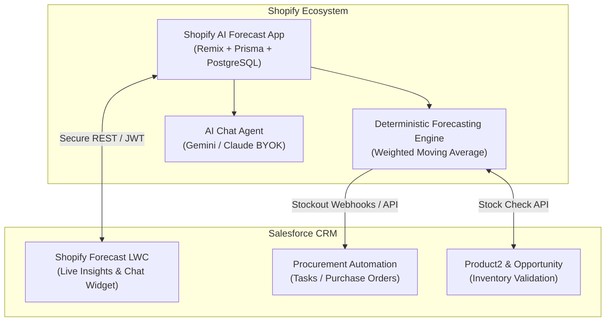

# Shopify AI Forecast & Inventory Intelligence Bridge

> **Open-Source (MIT)** | Companion to `shopify-ai-forecast-app` | Part of the Salesforce Open-Source Ecosystem Portfolio

---

## 1. Overview & Vision
A vertical open-source companion app connecting your **Shopify AI Forecast Agent** (`shopify-ai-forecast-app`) directly into Salesforce CRM.

While generic connectors only move raw orders and customer records, this specialized bridge brings **deterministic inventory forecasting, stockout warnings, and conversational AI insights** straight into Salesforce for procurement managers, operations teams, and B2B sales reps.

---

## 2. Killer Differentiators & Features
- 📈 **Proactive Stockout & Reorder Automation:** When the Shopify engine calculates that a SKU is hitting its reorder point (`days_of_cover <= lead_time`), automatically spawns an urgent Procurement Task or Purchase Order in Salesforce.
- 📊 **"Forecast Intelligence" LWC Component:** Embedded card on `Product2`, `Opportunity`, and Home pages displaying live multi-location stock, daily consumption velocity, days-of-cover, and stockout risk badges.
- 🤖 **In-Salesforce Conversational AI Agent:** Built-in chat interface powered by BYOK (Bring Your Own Key) Gemini / Claude architecture for querying inventory trends without hallucinations.
- 🛡️ **B2B Deal Protection (Opportunity Stock Check):** Validates inventory availability and projected restock dates in real time when sales reps add products to Opportunities or Quotes.

---

## 3. Architecture & Tech Stack

---

## 4. Standardized 4-Phase Delivery Roadmap

### 📋 Phase 1: Local Development & Differentiators
- [ ] Inbound webhook receiver Apex REST service (`ShopifyForecastReceiver.cls`).
- [ ] Forecast Intelligence LWC (`shopifyForecastIntelligence`) with SLDS metric tiles and status indicators.
- [ ] In-Salesforce AI Chat Assistant LWC with BYOK integration (`shopifyForecastChat`).
- [ ] Opportunity Line Item inventory validation trigger / invocable action.
- [ ] $\ge 85\%$ Apex unit test coverage and Jest test suite.

### 📋 Phase 2: GitHub & Open-Source Engineering
- [ ] Git repository initialized: `github.com/arsalan-arshad/shopify-ai-forecast-bridge`.
- [ ] Automated GitHub Actions CI workflow (`.github/workflows/ci.yml`).
- [ ] Automated CD workflow (`.github/workflows/cd.yml`).
- [ ] Protected `main` branch ruleset.

### 📋 Phase 3: 2GP Packaging & Distribution
- [ ] Second-Generation (2GP) Unlocked Package created: `ShopifyAIForecastBridge`.
- [ ] Package version built and validated against code coverage requirements.
- [ ] Promoted to **`Released`** status.
- [ ] Direct 1-Click Install URLs generated for Production and Sandbox.

### 📋 Phase 4: Branding & AppExchange Readiness
- [ ] 7 Visual Assets: App Icon (120x120), Hero Banner (16:9), and 4 UI walkthrough screenshots.
- [ ] Production-grade `README.md` with synergy guide connecting the Shopify App with Salesforce.
- [ ] Complete `APPEXCHANGE_LISTING.md` submission dossier.
