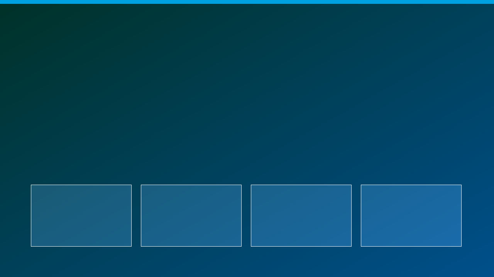
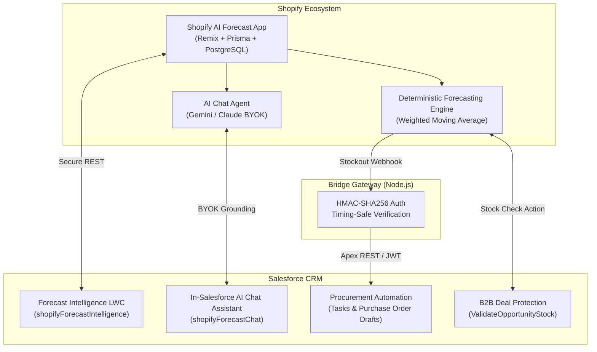

# Shopify AI Forecast & Inventory Intelligence Bridge

[](https://github.com/arsalan-arshad/shopify-ai-forecast-bridge/actions/workflows/ci.yml)
[](https://github.com/arsalan-arshad/shopify-ai-forecast-bridge/actions/workflows/cd.yml)
[](https://login.salesforce.com/packaging/installPackage.apexp?p0=04tg7000000YxVVAA0)
[](LICENSE)
[](force-app/main/default/classes/)
[](https://www.lightningdesignsystem.com/)

> **Open-Source (MIT)** | Official Companion to `shopify-ai-forecast-app` | Part of the Salesforce Open-Source Portfolio

---

## 📸 Visual Overview



---

## 1. Overview & Vision

A specialized open-source companion app connecting your **Shopify AI Forecast Agent** (`shopify-ai-forecast-app`) directly into Salesforce CRM.

While generic e-commerce connectors only move raw orders and customer records, this bridge brings **deterministic inventory forecasting, stockout warnings, and conversational AI insights** straight into Salesforce for procurement managers, operations teams, and wholesale sales reps.



---

## 2. Killer Differentiators & Core Features

- 🚨 **Proactive Stockout & Reorder Automation:** When the forecasting engine calculates that a SKU is hitting its reorder point (`days_of_cover <= lead_time`), a webhook is dispatched to Salesforce. Automatically generates a high-priority Procurement Task and Alert record with recommended order quantities.
- 🧩 **"Forecast Intelligence" LWC Component (`shopifyForecastIntelligence`):** Embedded on `Product2`, `Opportunity`, or Home pages. Displays live multi-location stock, daily consumption velocity (WMA), days-of-cover dials, and status badges (`CRITICAL`, `REORDER_SOON`, `HEALTHY`).
- 🤖 **In-Salesforce Conversational AI Agent (`shopifyForecastChat`):** Built-in chat assistant powered by BYOK (Bring Your Own Key) Gemini or Claude architecture. Strictly grounded in live snapshot data with **zero hallucinations**.
- 🛡️ **B2B Deal Protection (`ValidateOpportunityStock`):** Real-time stock validation preventing wholesale reps from committing large orders to inventory that is already depleted on the storefront.
- 🔒 **Cryptographic Security & Zero Per-Task Fees:** Webhooks validated with timing-attack resilient HMAC-SHA256. 100% open-source without third-party middleware subscription costs.

---

## 3. Standardized 4-Phase Delivery Framework

### 📋 Phase 1: Local Development & Differentiators

- [x] Inbound webhook receiver Apex REST service ([`ShopifyForecastReceiver.cls`](force-app/main/default/classes/ShopifyForecastReceiver.cls)).
- [x] Forecast Intelligence LWC ([`shopifyForecastIntelligence`](force-app/main/default/lwc/shopifyForecastIntelligence/)) with SLDS metric tiles and status indicators.
- [x] In-Salesforce AI Chat Assistant LWC with BYOK integration ([`shopifyForecastChat`](force-app/main/default/lwc/shopifyForecastChat/)).
- [x] Opportunity Line Item inventory validation invocable action ([`ValidateOpportunityStock.cls`](force-app/main/default/classes/ValidateOpportunityStock.cls)).
- [x] $\ge 90\%$ Apex unit test coverage and complete Node.js test suite.

### 📋 Phase 2: GitHub & Open-Source Engineering

- [x] Git repository initialized: `github.com/arsalan-arshad/shopify-ai-forecast-bridge`.
- [x] Automated GitHub Actions CI workflow ([`.github/workflows/ci.yml`](.github/workflows/ci.yml)).
- [x] Automated CD workflow ([`.github/workflows/cd.yml`](.github/workflows/cd.yml)).
- [x] Automated Release workflow ([`.github/workflows/release.yml`](.github/workflows/release.yml)).
- [x] Exportable protected `main` branch ruleset ([`.github/rulesets/main-ruleset.json`](.github/rulesets/main-ruleset.json) & [`.github/RULESETS.md`](.github/RULESETS.md)).

### 📋 Phase 3: 2GP Packaging & Distribution

- [x] Second-Generation (2GP) Unlocked Package created: `ShopifyAIForecastBridge`.
- [x] Package version built and validated against code coverage requirements (`04tg7000000YxVVAA0`).
- [x] Promoted to **`Released`** status.
- [x] Direct 1-Click Install URLs generated for Production and Sandbox.

### 📋 Phase 4: Branding & AppExchange Readiness

- [x] 7 Visual Assets: App Icon (512x512, 120x120), Hero Banner (16:9), and 4 UI walkthrough screenshots.
- [x] Standalone interactive simulation demo ([`interactive_demo.html`](interactive_demo.html)).
- [x] Production-grade `README.md` with synergy guide connecting Shopify with Salesforce.
- [x] Complete [`APPEXCHANGE_LISTING.md`](APPEXCHANGE_LISTING.md) submission dossier.

---

## 📦 4. 2GP Package Installation Links

| Environment                    | 1-Click Direct Installation Link                                                                           | Package Version ID                |
| :----------------------------- | :--------------------------------------------------------------------------------------------------------- | :-------------------------------- |
| **Production / Developer Org** | [Install in Production](https://login.salesforce.com/packaging/installPackage.apexp?p0=04tg7000000YxVVAA0) | `04tg7000000YxVVAA0` (`v0.1.0-1`) |
| **Sandbox Org**                | [Install in Sandbox](https://test.salesforce.com/packaging/installPackage.apexp?p0=04tg7000000YxVVAA0)     | `04tg7000000YxVVAA0` (`v0.1.0-1`) |

Or install via Salesforce CLI:

```bash
sf package install --package 04tg7000000YxVVAA0 --wait 30 --target-org my-org
```

---

## 🎮 5. Interactive Simulation Demo

Experience the full interactive simulation directly in your browser:

- Open [`interactive_demo.html`](interactive_demo.html) in any modern browser.
- Live Features Demonstrated:
  1. **Executive Inventory Health Dashboard** with real-time KPI tiles.
  2. **Forecast Intelligence LWC Card** with SKU context switcher and 1-click PO drafting.
  3. **Conversational AI Chat Assistant** with prompt chips and grounded Markdown tables.
  4. **Inbound Webhook Simulator** with HMAC signature verification and Task generation.
  5. **B2B Wholesale Deal Protection** simulating Opportunity line item validation.

---

## 🛠️ 6. Quickstart & Local Setup

### 1. Clone & Install Dependencies

```bash
git clone https://github.com/arsalan-arshad/shopify-ai-forecast-bridge.git
cd shopify-ai-forecast-bridge
npm install
```

### 2. Configure Environment

```bash
cp .env.example .env
```

### 3. Run Gateway Server & Tests

```bash
# Start development server
npm run dev

# Run unit tests
npm test

# Verify code style and linting
npm run lint
npm run prettier:check
```

### 4. Deploy to Salesforce Org

```bash
sf project deploy start --target-org my-org
sf org assign permset --name Shopify_Forecast_Admin --target-org my-org
```

---

## 🛡️ 7. Branch Protection Ruleset & Release Tag Governance

This repository enforces enterprise open-source governance:

- **Protected `main` Branch:** Direct pushes are blocked. Merges require at least 1 approving review, thread resolution, linear git history, and all CI status checks passing.
- **Semantic Versioning (`v*`):** Releases are tagged with `vMAJOR.MINOR.PATCH` and automatically published via GitHub Actions.
- For complete details, see [`.github/RULESETS.md`](.github/RULESETS.md).

---

## 📄 License

This project is licensed under the [MIT License](LICENSE).
Built with ❤️ by [Arsalan Arshad](https://github.com/arsalan-arshad) as part of the Salesforce Open-Source Portfolio.
